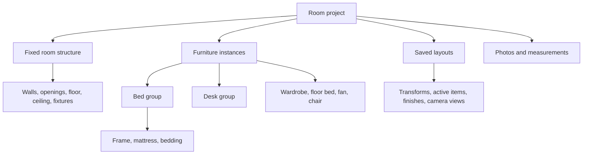

# Room Decor: research and proposed build plan

Research date: 28 October 2026. Status: planning only; no application, room model, sensor capture, or reconstruction has been built or run.

## Product direction

Create an editable model of a person's actual room. Keep the room structure separate from furniture, so the person can rearrange existing belongings, remove or replace an item, test a prospective purchase at its stated dimensions, try wall finishes, and walk through alternative layouts.

Recommended first version: phone capture and measurement, followed by a responsive browser editor that is easiest to edit on a laptop and remains usable on the phone. Use the supplied Dream Room viewer as the interaction and visual reference, with Blender for preparing geometry and GLB for delivery to the browser. Keep an ordinary photo-and-measurement route available even when automated scanning fails.

The first useful milestone is one recognizable, dimensioned, editable room with its major furniture. Detailed reconstruction and automated object extraction can improve this milestone later.

## What the supplied photos establish

These observations come from the ten photos and the user's description; they are not measured geometry.

| Component | Evidence and treatment |
|---|---|
| Room structure | Walls, floor, ceiling, a ceiling beam/soffit, door and windows are visible. Treat as fixed geometry, with separately editable wall finishes. The full outline and opening positions need measurement. |
| Wooden bed | Clearly visible from multiple angles. Group frame, mattress, pillows and bedding under one movable bed. Use outer frame dimensions rather than mattress size for fit. |
| Wardrobe/cupboard | Clearly visible. Model its body and door-opening clearance; top luggage can be an attached optional group. |
| Green desk | Clearly visible from two directions. Move the desk as a whole; optionally attach its laptop and small objects. Account for access to sockets. |
| Floor bed/mattress | The red covered floor item matches the user's description of a floor bed. Confirm its footprint and thickness rather than inferring them from the fabric. |
| Pedestal fan | A separate movable floor object. Distinct from the ceiling fan. |
| Desk chair | Partly visible in the desk photo; require a clearer view or use a measured generic chair. Include space to pull it out. |
| Ceiling fan, lights, sockets | Fixed fixtures for this version. They should not behave like furniture dragged across the floor. |
| Curtains and loose belongings | Optional detail. Keep curtains attached to windows initially and small clutter out of placement calculations. |

The photos provide useful appearance references. Bright windows, blur, occlusion and repeated views limit reconstruction. They do not establish room dimensions, hidden surfaces, complete door swing, or purchase-grade fit. A visually convincing model can still have the wrong scale.

## Capture research and the actual phone

Read-only ADB inspection identified the connected phone as **POCO X5 Pro 5G**, model **22101320I**, running **Android 14**. The user confirmed the phone model. Android reports accelerometer and gyroscope features, and Google Play Services for AR is installed. No camera was started, no recording was made and no app was installed.

Google lists the POCO X5 Pro 5G as supporting the ARCore Depth API. This is a useful capability, but a running capture session must still check support and tracking quality. ARCore depth combines multiple camera views and can use additional depth hardware when available. Google notes that low-texture surfaces can produce imprecise depth. [Device list](https://developers.google.com/ar/devices), [Depth API](https://developers.google.com/ar/develop/depth).

Use ARCore's camera and inertial tracking together if we add native scanning. Raw gyroscope/accelerometer readings are not a substitute for room geometry or reliable position tracking; ARCore estimates camera pose by combining visual features with IMU measurements. Existing photographs do not contain a synchronized inertial tracking stream. [ARCore fundamentals](https://developers.google.com/ar/develop/fundamentals).

| Route | What it offers | Decision |
|---|---|---|
| Photos plus measurements | Broad compatibility, explicit scale, simple correction | First milestone and permanent fallback. |
| Native Android ARCore capture | Camera poses, depth where supported, guided scanning | Best automation experiment for this phone, after the editor's data contract is defined. Depth does not itself provide editable furniture identities. |
| Apple RoomPlan | Parametric room elements and recognized furniture using camera and LiDAR; USD/USDZ export | Future iOS adapter, not the route for this Android phone. [Apple overview](https://developer.apple.com/augmented-reality/roomplan/). |
| Photogrammetry | Geometry from overlapping images taken at different positions | Optional reference reconstruction. White walls and hidden furniture surfaces make success uncertain here. [COLMAP guidance](https://colmap.github.io/tutorial.html). |
| Whole-room photographic mesh or splat | Potentially richer appearance reference | Optional viewing layer. It still needs separation into objects and completion of revealed floor/walls when furniture moves. This is an engineering assessment, not a tested result on these photos. |

Detailed capture positions and the measurement checklist are in [CAPTURE_GUIDE.md](CAPTURE_GUIDE.md).

## Existing products and research worth learning from

IKEA Kreativ already demonstrates the scan-on-phone, edit-on-phone-or-computer workflow. Its documented eraser can remove furniture from photographic scans, while its whole-room route begins with an empty room. Our proposed emphasis is retaining the user's existing items as movable, dimensioned objects alongside replacement items. This is a product direction, not a claim of unique market coverage. [Capture workflow](https://www.ikea.com/us/en/customer-service/knowledge/articles/e86d70g6-3673-4306-b373-20f7cg7fd5ed.html), [Eraser behavior](https://www.ikea.com/us/en/customer-service/knowledge/articles/6226432c-c257-4d49-bf04-cede16cae5c5.html).

Polycam documents distinct space, floorplan and object capture modes. This supports keeping room-structure capture and detailed furniture capture separate. An import adapter could be useful later, but we have not tested exports or established that they preserve the object grouping needed here. [Capture modes](https://learn.poly.cam/hc/en-us/articles/48565771018772-Which-Capture-Mode-Should-I-Use).

SAM 3D Objects can generate object geometry, texture and layout from masked objects in a photograph. It is worth a later appearance experiment. Its official setup specifies Linux and an NVIDIA GPU with at least 32 GB VRAM, plus access to checkpoints. Treat generated hidden geometry and scale as estimates requiring correction. It is not a dependency for the first room. [Project](https://github.com/facebookresearch/sam-3d-objects), [Setup](https://github.com/facebookresearch/sam-3d-objects/blob/main/doc/setup.md).

VGGT estimates camera and scene geometry from images and is another optional reconstruction experiment. The project distinguishes its original checkpoint from the commercially usable checkpoint. Neither its output nor a point cloud automatically supplies a complete furniture editor. No 3D ML pipeline was installed or benchmarked in this research. [Project and checkpoint notes](https://github.com/facebookresearch/vggt).

## Proposed experience

1. **Capture:** upload reference photos, enter dimensions, or later import an AR scan. Show which walls, corners and objects still need evidence.
2. **Confirm:** review the room outline and an inventory of detected or manually added items. Correct labels and dimensions before editing.
3. **Arrange:** select a whole item, drag it on the floor, rotate, snap to a wall, hide/store it, or replace it. Show dimensions and clearances during placement.
4. **Style:** recolor individual walls or add a configurable accent region. Keep ceiling, trim and curtains independently selectable. Save finish choices per layout.
5. **Explore:** switch among plan, orbit and walk views; use mouse/keyboard on laptop and touch controls on phone. Optional gyro look can follow after permission and device testing.
6. **Compare:** keep an unchanged original layout and named alternatives, with undo/redo and saved camera positions.

Preserve the reference's dark green background, warm accent, large room viewport and restrained controls. Adapt the bottom cards into layout alternatives. On laptop, add an inventory panel and a compact properties panel. On phone, use an object tray and bottom sheet. Distinguish dragging furniture from orbiting the camera through an explicit edit mode.

## Component and asset model

Each furniture asset needs a stable ID, semantic type, editable parent group, outer dimensions, pivot, floor-contact point, collision footprint, clearance regions, material slots and source information. A scene instance adds position, yaw, visibility and attachment relationships. Layouts reference asset IDs rather than duplicating all geometry.

Store measurement provenance per dimension: user-measured, seller-specified, scanned or inferred. Unknown dimensions remain unknown; do not invent confidence percentages. Use metres internally and centimetres or millimetres in the UI. GLTF uses metres and Y-up, so Blender/native imports need explicit coordinate conversion. [GLTF specification](https://github.com/KhronosGroup/glTF/blob/main/specification/2.0/Specification.adoc#coordinate-system-and-units).

Use simple parameterized furniture first, with appearance based on the photos. Prepare reusable Blender assets for the bed, wardrobe, desk, floor mattress, pedestal fan and chair. Export each as an editable group in GLB. Future product imports can use a supplied GLB or a dimensioned proxy if no model exists. Keep verified product dimensions locked during ordinary placement; any deliberate resizing creates a hypothetical variant.

A wall-color preview is approximate under the chosen lighting. Preserve a clean, continuous floor and walls behind furniture so removing an item reveals plausible geometry. Photo-derived material colors require correction because the supplied images contain strong lighting differences.

## Fit and navigation rules

Fit has several separate questions:

- Does the object's complete footprint stay within the room and avoid other objects?
- Can the room door, wardrobe doors and drawers open?
- Is there usable space for the chair and access to the bed, windows and sockets?
- Is there a connected walkable route from the doorway to intended destinations?
- Are the input dimensions verified closely enough to decide a tight fit?

Use oriented footprints for rotated furniture, vertical ranges for overlap, explicit door-swing regions and adjustable usage clearances. Inflate obstacles by a configurable walking radius when checking routes. Thresholds are project preferences, not asserted building standards. Refresh collision data whenever an item moves or changes dimensions. A working virtual walk mode alone does not prove real-world usability.

Report fit as compatible with verified inputs, conflicting, or needing measurement. If the remaining gap is smaller than measurement uncertainty plus the selected margin, request verification instead of showing a confident fit. Physical delivery through doors or corridors is a separate later check; successful final placement does not establish delivery feasibility.

## Architecture and implementation order

Proposed stack: a small TypeScript browser application using Three.js, GLB assets and versioned project JSON, with local persistence and file export first. React/Vite is a reasonable UI scaffold when the editor is built, but no framework installation is needed during planning. Blender is the offline authoring/export tool; it should not be required on the user's phone or for each drag operation. Three.js supplies GLB loading and object transform controls. [GLTFLoader](https://threejs.org/docs/pages/GLTFLoader), [TransformControls](https://threejs.org/docs/pages/TransformControls.html).

Keep capture import, project state, asset registry, placement validation and rendering as separate modules. A future native Android companion should export RGB keyframes, timestamps, intrinsics, camera poses, optional depth/confidence and tracking status into that same project pipeline. A browser upload screen does not automatically expose native ARCore data. Browser XR support varies, so it should be an optional capability. [WebXR specification](https://www.w3.org/TR/webxr/).

| Phase | Deliverable | Completion evidence |
|---|---|---|
| 1. Calibrate | Dimensioned room outline and confirmed furniture inventory | Recorded room/opening measurements; each item marked measured or inferred; unknowns visible. |
| 2. Edit one room | Original layout; movable grouped furniture; plan/orbit/walk; hide/replace; undo/save | Moving the bed moves all attached parts; reload restores layout; controls work on laptop and this phone. |
| 3. Validate and style | Updated collisions, door/usage clearances, routes, wall finishes and layout comparison | Deliberately blocked doors and overlapping furniture are detected; a valid doorway route is navigable; finishes persist. |
| 4. Add purchases | Small reusable asset library, dimension entry and GLB import | A dimensioned replacement fits or conflicts consistently in plan and 3D; uncertain inputs are identified. |
| 5. Improve capture | ARCore feasibility trial and optional reconstruction | On-device capability check; repeated comparison against tape measurements and tracking failure recovery before making accuracy claims. |

Phases 1–4 define the useful first release. Phase 5 can start with a short capability experiment once building is authorized, but must not block manual capture. There is no basis yet for a reliable automated-reconstruction latency, cost or accuracy estimate. The first editor needs no paid generation service; optional GPU processing should be estimated separately before adoption.

## Next inputs and current limits

The subsequently supplied narrated video has been reviewed in [VIDEO_REVIEW.md](VIDEO_REVIEW.md). It connects the entrance, work area, bed, wardrobe and floor-bed regions, clarifies the two windows, and reveals a small stool. The office chair is now clearly visible. Use it with the original photos as modeling evidence; overview photos need not be repeated just to establish those relationships. Metric dimensions and door swing remain unverified.

The user confirmed the reference repo is the app/UI they meant. The remaining useful inputs are the measurements and supplementary views in the capture guide. They are not required to finish planning; a prototype can use clearly labeled estimated dimensions until they arrive.

Repository source and GLB structure were inspected at a pinned commit; see [REFERENCE_REPO_AUDIT.md](REFERENCE_REPO_AUDIT.md). This work did not run a browser interaction test, benchmark this phone's GPU, perform a live ARCore scan, or reconstruct the photos. Those are explicit build-phase checks.
